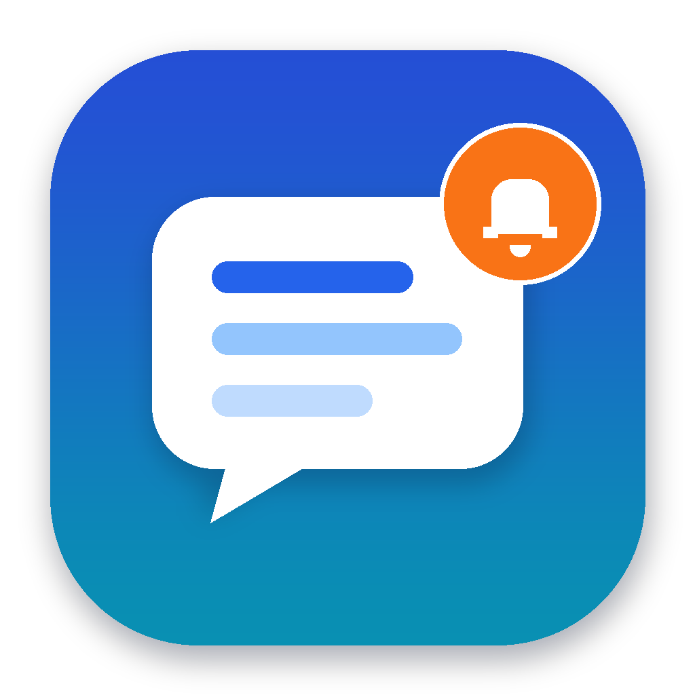
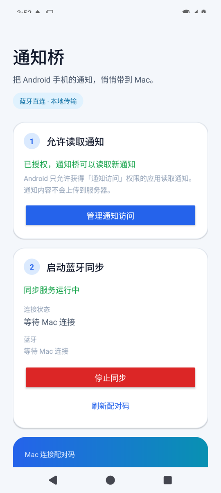
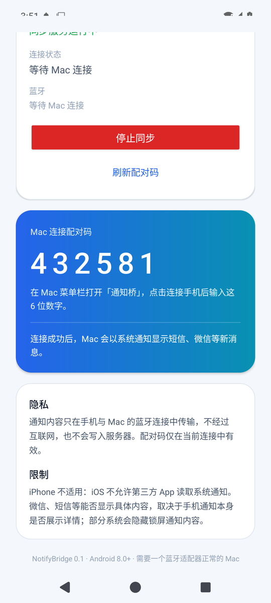

# 通知桥 NotifyBridge



把 Android 手机收到的新通知（短信、微信、其他 App）转发到 Mac，并在 macOS 通知中心显示标题和正文。默认走**低功耗蓝牙**；手机不在身边时，可以自动改用**局域网 / Tailscale 直连**，或可选的**自建云中转**。

这是一个可运行的原型：首次配对后，蓝牙断线会回到原来的自动重连；同时新增的网络通道会独立保持连接，哪条通道先到就用哪条，重复通知自动去重。默认流量不经过第三方服务器；启用云中转时，内容在手机端加密，服务器只转发密文。

---

## 先说结论：iPhone 能不能做？

**不能做通用的第三方 App。** 这不是技术难度问题，而是平台限制：

- iPhone 没有向第三方 App 开放“读取其他 App 通知”的公开 API。App Store 审核也不允许应用读取系统通知或其他 App 的内容。
- 苹果自己的「iPhone 镜像」可以在 Mac 上显示 iPhone 通知，但那是系统 Continuity 功能，第三方无法调用。
- Apple 的 ANCS（Apple Notification Center Service）是面向蓝牙配件的通知服务，不是给普通 Mac App 读取 iPhone 通知的公开接口，也不能覆盖微信等所有 App。
- 越狱或私有 API 可以绕过，但不适合作为产品，也不在本项目范围内。

**Android 可以。** Android 提供了 `NotificationListenerService`，用户明确授权后，应用可以读取通知栏中的通知（包括短信和微信通知，前提是通知本身显示了内容）。KDE Connect、Phone Link 等产品也是这个原理。

本项目实现的是：

| 手机 | 支持情况 |
| --- | --- |
| Android 8.0+（带 BLE 广播） | ✅ 本仓库 |
| iPhone | ❌ 无第三方公开接口；使用系统「iPhone 镜像」 |
| HarmonyOS 4 及以下（兼容 APK） | ⚠️ 未测试，可能可用 |
| HarmonyOS NEXT | ❌ 不运行 APK |

---

## 手机不在身边，也能收到吗？

可以，但要满足一个前提：**手机仍然开机、有电、联网**。通知桥不是把手机“变成不用开机”，而是让手机留在家里当转发端，你在 Mac 上收通知。

| 场景 | 走哪条通道 | 需要配置 |
| --- | --- | --- |
| 手机在 Mac 旁边 | 蓝牙（自动） | 首次 6 位配对码 |
| 手机在家，Mac 在同一 Wi-Fi | 局域网（自动发现） | 手机端启动同步即可 |
| 手机在家，Mac 在公司/外地 | Tailscale 直连 | 两端装 Tailscale，Mac 填手机 tailnet 地址 |
| 没有 tailnet，或需要离线排队 | 云中转 | 一台 TLS 中继服务器 + 两端同一密钥 |

三条网络通道与蓝牙可以同时运行。Mac 菜单栏会显示当前可用路径；某条断了会自动退避重连。更完整的协议、部署和安全边界见 [docs/network.md](docs/network.md)。

### 能不能不装 Tailscale？

可以。用**云中转**：手机和 Mac 各只装「通知桥」，不再装 Tailscale；代价是需要一台公网可达的服务器（VPS / 云主机 / 有公网地址的 NAS）。服务器只跑一个容器，手机和 Mac 都主动外连它，不需要在服务器上装客户端 App。

| 方案 | 手机 App | Mac App | 额外设备 | 适合 |
| --- | --- | --- | --- | --- |
| 蓝牙 / 局域网 | 通知桥 | 通知桥 | 无 | 在家，近距离 |
| Tailscale | 通知桥 + Tailscale | 通知桥 + Tailscale | 无（用 Tailscale 协调服务） | 异地，不想维护服务器 |
| 云中转 | 通知桥 | 通知桥 | 1 台公网服务器 | 异地，想少装 App |
| 公共中继（如 ntfy.sh） | 通知桥 | 通知桥 | 第三方服务 | 轻量试用；依赖第三方，国内可达性不一定 |

**完全“不装额外 App、也不准备任何服务器”是做不到的**：手机在蜂窝网络下位于运营商 NAT 后，没有公网入口，Mac 无法凭空找到它。必须有一个公网 rendezvous/relay（云中转），或者一个 VPN overlay（Tailscale）。把 Tailscale 客户端嵌进 App 在技术上可行（macOS 可用 userspace `tsnet`，Android 需要 `libtailscale`/gomobile 和 VpnService），但工程量大、包体大，而且仍然需要 Tailscale 账号和协调服务；对这个原型不划算。云中转客户端已经内置在 0.2.x 里，是最省 App 的现实路径。

---

## 它长什么样

- **Android 端**：打开通知访问 → 启动同步 → 显示 6 位配对码；前台服务同时保持 BLE 广播、TCP 服务（47821）和可选的云中转连接。
- **Mac 端**：菜单栏图标 → 首次输入配对码；之后新通知以 macOS 横幅显示。蓝牙、局域网、Tailscale 与云中转会同时尝试，断线后自动重连。
- **网络设置**：手机和 Mac 都有「网络与中继设置…」，用于配置 Tailscale 地址、云中转地址与端到端密钥。
- 不显示 Dock 图标（`LSUIElement`），只占菜单栏。
- 通知内容格式：标题为发件人/会话，副标题为 App 名称，正文为消息内容。

示例：

```text
张三
微信
晚上一起吃饭吗？
```

### 界面预览

以下截图来自 Android 15 模拟器，服务已启动并在等待 Mac 连接（模拟器的虚拟蓝牙没有桥接到宿主机，所以没有完成真实连接）：

| 首页 | 配对码 |
| --- | --- |
|  |  |

---


## 架构

```text
┌──────────────────────────── Android ────────────────────────────┐
│  NotificationListenerService                                    │
│    └─ 过滤 group summary / ongoing / 重复通知                     │
│    └─ 读取 EXTRA_TITLE / EXTRA_TEXT / MessagingStyle             │
│                    │ JSON                                       │
│                    ▼                                            │
│  FrameCodec：4 字节头 + 16 字节内容，拆成 20 字节 BLE 通知帧       │
│  TCP 47821 / 云中转客户端（与 BLE 并列）                          │
│                    │                                            │
│  BluetoothGattServer（外设）                                     │
│    ├─ TX characteristic：Notify → Mac                            │
│    ├─ RX characteristic：Write ← Mac（配对码 / 心跳）             │
│    └─ 扫描响应：Manufacturer Data = 8 字节稳定设备 ID             │
└────────────────────────────┬────────────────────────────────────┘
                             │ BLE（近场）
┌────────────────────────────▼────────────────────────────────────┐
│  macOS 菜单栏 App（CBCentralManager）                             │
│    ├─ 扫描服务 UUID + 设备 ID → 自动连接                          │
│    ├─ 订阅 TX，发送保存的配对码；每 8 秒写一次心跳                 │
│    ├─ 重组帧 → 解码 JSON → UNUserNotificationCenter              │
│    └─ 断线后持续扫描，发现同一设备后自动恢复                      │
└─────────────────────────────────────────────────────────────────┘
```

BLE 服务与 TX/RX 的 UUID、帧格式、JSON 字段和配对流程见 [docs/protocol.md](docs/protocol.md)。

网络通道与 BLE 并列，不替代它：

```text
NotificationHub
  ├─ BLE GATT（近场，自动）
  ├─ TCP 47821：局域网 Bonjour / Tailscale 手动地址（同一协议）
  └─ 云中转：TLS + AES-GCM，服务器只转发密文
```

手机端把同一条通知分发给所有已启用通道；Mac 端按「通知 ID + 手机发送时间」去重，所以多通道同时在线不会重复弹窗。网络协议、断线补发、云中转加密和部署见 [docs/network.md](docs/network.md)。

---

## 快速开始

### 0. 直接用已经打好的包

构建产物通过 GitHub Releases 发布，二进制不进 Git（`dist/` 只保留 `SHA256SUMS.txt`）：

- 最新发布：<https://github.com/Milesld/Display-notifications-for-Android-phones-on-Mac/releases/latest>
- `NotifyBridge-macOS-0.2.2.dmg`：Mac 安装包（Apple Silicon；本次发布 Mac 端代码未改动）。
- `NotifyBridge-macOS-0.2.2.zip`：同样的 `.app` 压缩包。
- `NotifyBridge-Android-0.2.5-debug.apk`：可直接安装的 Android debug 包。
- `SHA256SUMS.txt`：三个产物的校验和。

Mac 端没有经过 Apple 公证（ad-hoc 签名），首次打开如果被 Gatekeeper 拦住，右键 App →「打开」。Android 包使用 debug 签名，适合自用测试，不适合上架。

### 1. 构建并启动 Mac 端

要求：macOS 13+，已安装 Xcode Command Line Tools（`xcode-select --install`）。

```bash
./scripts/build-macos.sh
open dist/NotifyBridge.app
```

首次启动会请求两个权限，首次使用局域网发现时还会请求第三个：

1. **蓝牙**：用于扫描和连接手机。
2. **通知**：用于在 Mac 上显示同步过来的消息。
3. **本地网络**（macOS 15+）：用于通过 Bonjour 发现同一 Wi-Fi 下的手机；拒绝后仍可使用 Tailscale/云中转。

如果通知权限被拒绝，菜单栏「通知权限：未开启」可以打开系统设置。也可以先点「发送测试通知」验证 Mac 端显示链路。

App 是本地 ad-hoc 签名，放在 `dist/NotifyBridge.app`。拷贝到 `/Applications` 也可以。**每次重新构建后 ad-hoc 签名会变化，macOS 可能重新弹出蓝牙授权**；必须点「允许」，否则 App 会停在初始化状态、无法扫描。

运行时日志：`~/Library/Logs/NotifyBridge.log`。

> 如果「通知权限」显示未开启，请到系统设置 → 通知 → 通知桥 打开允许通知；菜单里的「通知权限设置…」可以直接跳转。

### 2. 构建 Android 端

要求：

- JDK 17
- Android SDK Platform 35、Build Tools 34.0.0 或 35.0.0
- Gradle 8.9+（或 Android Studio）

```bash
cd android
# 如果没有设置 ANDROID_HOME，创建 local.properties：
# echo "sdk.dir=/path/to/Android/sdk" > local.properties
./gradlew assembleDebug
adb install -r app/build/outputs/apk/debug/app-debug.apk
```

> 项目包含标准的 Gradle Wrapper 8.9（`gradlew` + `gradle/wrapper/gradle-wrapper.jar`）。首次运行会下载官方 Gradle 8.9；也可以直接用 Android Studio 打开 `android/`。

本项目的开发环境已经完成 APK 构建、aapt 清单检查、单元测试，并在实体 Android 手机上验证过 BLE 配对与通知转发。自动重连与网络通道需要同时安装本次更新后的 Android APK 和 Mac App（见“验证状态”）；只更新一端时 BLE 仍可用，但不会出现新的网络设置。

### 3. 在手机上设置

1. 安装并打开「通知桥」。
2. 点「去授权」，在系统设置里允许「通知桥」读取通知。
3. 回到 App，点「启动同步」。
4. 如果系统弹出蓝牙/附近设备权限，选择允许。
5. 记下屏幕上的 6 位配对码。

### 4. 在 Mac 上连接

1. 点击菜单栏的「通知桥」图标。
2. 选择「连接手机」。
3. 输入手机上的 6 位配对码。
4. 菜单显示「已连接并已配对，自动重连已开启」后，让手机收到一条新消息即可测试。

首次配对成功后，Mac 会把配对码和这台手机的稳定 ID 保存在本机。之后：

- 手机走出蓝牙范围再回来：Mac 自动扫描并连接，自动重新配对。
- Mac 重启、App 重启：自动连接。
- 手机蓝牙关掉再打开：旧版手机 App 需要手动重启同步；新版会监听蓝牙状态并重新广播。
- 手动点「断开连接」会暂停自动重连；再点「连接手机」并配对后恢复。
- 手机 App 里刷新配对码会让 Mac 保存的旧码失效，需要手动重新输入新码。

Mac 端也可以通过「发送测试通知」只测试本机通知权限，不需要手机。

### 5. 可选：让手机不在身边也能收

**先完成一次蓝牙配对**，Mac 会保存 6 位配对码；局域网和 Tailscale 直连会复用它。之后：

- **局域网（同 Wi-Fi）**：手机端保持「启动同步」，Mac 会自动通过 Bonjour 发现手机，不需要额外配置。
- **Tailscale（异地）**：
  1. 手机和 Mac 都安装 Tailscale，登录同一个 tailnet。
  2. 在手机上允许 Tailscale 的 always-on VPN，并把「通知桥」加入电池优化白名单。
  3. 查手机的 tailnet 地址：浏览器打开 <https://login.tailscale.com/admin/machines>，找到手机 → 详情里有 **Tailscale IP（100.x.y.z）** 和 **MagicDNS name**（如 `pixel-8.tailnet-abc123.ts.net`），复制一个。手机上 Tailscale App 的设备详情页也能看到 100.x 地址；Mac 终端可用 `tailscale status`。
  4. 在 Mac 菜单栏 →「网络与中继设置…」勾选「启用局域网 / 远程直连」，填写 `手机地址:47821`，例如 `pixel-8.tailnet-abc123.ts.net:47821` 或 `100.101.102.103:47821`。
  5. 在 Mac 终端用 `tailscale ping 手机设备名` 和 `nc -vz 手机地址 47821` 验证（详见 [docs/network.md](docs/network.md)）。
- **云中转（没有 tailnet，或要离线排队）**：
  1. 按 [server/README.md](server/README.md) 在一台可访问的服务器上启动中继（TLS）。
  2. 手机「网络与中继设置…」→ 生成密钥 → 填中继地址 `relay.example.com:443` → 勾选启用。
  3. Mac「网络与中继设置…」→ 填同一个地址 → 粘贴同一密钥 → 勾选启用。

Mac 菜单里的「状态」会显示当前可用路径，例如「已连接：蓝牙 + 局域网 + 云中转」。如果手机离开蓝牙范围，网络通道会继续送达；重复通知按 ID + 发送时间去重。详细协议与安全说明见 [docs/network.md](docs/network.md)。

> 手机仍然必须开机、有电、联网。Android 厂商可能杀前台服务，建议把通知桥设为「不受限制/允许后台运行」，关闭电池优化。

---

## 验证状态

已经在本机验证：

- `swift build` 编译 macOS 端成功。
- `swift run ProtocolSelfTest`：原有 BLE 帧/JSON 测试全部通过；新增 TCP 分帧、HKDF 跨语言向量、AES-GCM、嵌套通知 JSON、地址解析测试也全部通过（共 58 项）。
- macOS `.app` 打包、ad-hoc 签名和 `codesign --verify` 通过。
- App 可启动，菜单栏进程正常，CoreBluetooth 进入 poweredOn 并开始扫描。
- Android 工程在本机用 JDK 17 + Android SDK 35 + Gradle 8.9 构建成功；`FrameCodecTest` 6/6、`NotificationMergeTest` 4/4、`TcpFrameTest` 3/3、`NetCryptoTest` 4/4 通过。
- APK 清单包含通知监听组件、BLE 权限，以及新网络通道需要的 `INTERNET` / `ACCESS_NETWORK_STATE` / `CHANGE_WIFI_MULTICAST_STATE` / `WAKE_LOCK`。
- **直连 TCP 端到端（Mac 侧）**：用模拟手机在 `127.0.0.1:47821` 完成 hello/auth/auth_ok、推送通知、Mac 弹窗并回 ACK。
- **直连 TCP 端到端（Android 侧）**：Android 15 模拟器 + `adb forward` + 本机 Node 客户端 / Mac App，完成 auth、测试通知、Mac 弹窗、ACK；Android 服务同时成功注册 Bonjour（mDNS），并验证了 `WAKE_LOCK`/Wi-Fi 锁和后台广播不会阻塞。
- **云中转端到端**：启动真实 TLS 中继，模拟手机用同一密钥做 HKDF + AES-GCM，Mac 解密后弹窗并 ACK；服务器的队列、离线补发和重启持久化由 `server/test/relay-test.js` 验证通过。
- 跨语言加密向量一致：Android、Swift、Node 三端的 HKDF channel/token/encKey 和 AES-GCM 往返测试使用同一组固定向量。
- Android 15 模拟器（API 35）安装/启动、通知访问授权、前台服务、BLE 广播仍正常；新版还额外验证了 TCP 监听、Bonjour 注册和 adb 端口转发下的完整收发。
- 使用实体 Android 手机与 Mac 完成了真实的 BLE 配对和通知转发：短信、微信通知均成功到达 Mac。
- 自动重连：预置配对信息后重启 Mac App，App 在扫描到手机后**无需点击**自动连接并自动发送配对码；故意使用错误配对码时，手机会返回配对失败，Mac 保留保存的配对信息并提示手动输入新码（0.2.2 起不再清除，也不再停用自动重连）。
- 重复通知修复：Android 改用稳定 notification key 作为 ID、按消息时间选择最新短信、跳过没有更新消息时间的通知更新；Mac 兼容旧 ID 并增加 2 秒相同内容去重。相关 ID 归一化测试已通过，APK/Mac App 均已重新构建。
- 首次连接失败修复：日志确认首次连接报 `Device is invalid`（手机轮换 BLE 地址后缓存对象失效），第二次才成功。新版会选择最近扫描对象、按稳定 ID 替换旧对象，并在连接失败时保留配对码自动重扫重试一次。
- 次日重连风暴修复：日志显示旧版在 Mac 睡眠/蓝牙反复开关期间持续连接弱信号手机，最终报 `maximum number of connections for this client`。新版增加指数退避、连接数上限 2/5 分钟冷却、弱信号（< -88 dBm）不自动连接、以及退避期间停止扫描。
- 连接后无通知诊断：Mac 端配对成功后会显示手机通知访问是否开启；手机端新增「发送测试消息到 Mac」按钮，可区分“BLE 通道问题”与“手机通知监听/授权问题”。Android 发送通知帧新增 8 秒 watchdog，避免发送队列卡死后永久无通知。
- 通知监听掉线诊断（0.2.1）：Mac 菜单会在手机通知监听未就绪时显示「手机通知监听未就绪」；Android 端会区分「已授权但监听服务未连接」，并提供「重新连接通知监听」按钮，前台服务每 60 秒检查并请求重绑。
- 隔夜/周末重连修复（0.2.2）：日志确认这台 Mac 空闲时每 45 秒进入一次维护性睡眠，每次睡眠都会把蓝牙控制器断电，旧版把每次断电都当成“用户关了蓝牙”并从头扫描；同时连接请求没有超时，一次挂起就会让 App 停在“正在连接”、不再扫描、菜单项变灰，配对码自然输不进去。新版：
  - Mac 监听系统睡眠/唤醒，醒来清掉挂起的连接、退避和冷却后重新扫描；睡眠期间的蓝牙断电不再当成错误。
  - 连接、服务发现、配对协商各加 12–15 秒看门狗；超时主动断开并按退避重试，不会再无限挂起。
  - 手机返回配对失败时保留保存的配对码、不再停用自动重连；链路保持连接，菜单里的「输入配对码…」可以直接输新码。
  - 心跳期间禁止 App Nap，避免 8 秒心跳被系统节流后触发手机端 30 秒超时。
  - 菜单新增「重置蓝牙连接」，卡住时一键丢弃挂起请求并重新扫描。
  - Android 端增加广播看门狗（广播丢失/失败会自动重启）、半开连接 15 秒回收、拒绝第二个 central，并对非当前设备的写入返回失败而不是静默丢弃。
- Android 首页布局（0.2.3）：把 6 位配对码卡片移到网络通道卡片之前；启动同步、刷新配对码，或在未配对时重新打开 App，页面会自动滚到配对码，不用再手动下拉。Mac 端仍为 0.2.2，两端协议不变，可混装。
- Android 文案（0.2.4）：第二步「启动蓝牙同步」改为「启动同步服务」；卡片内「连接状态 / 蓝牙」改为「同步状态 / 蓝牙通道」，同步状态会标明当前走蓝牙、网络，还是两者都有；前台通知也按通道显示。
- 通知监听修复（0.2.5）：已授权但监听服务未连接时，点「重新连接通知监听」会请求重绑并直接打开系统通知访问页，不再只弹一句 toast；监听被系统重绑（onRebind）时也会把状态更新为已连接，不会卡在「监听服务未连接」。
- 通知权限诊断：macOS 系统日志显示通知已按 banner 投递（`Presenting ... as banner`），但被当前启用的专注模式以 `DND suppression: delay` 暂缓，因此只进入通知中心。系统设置中的通知桥样式为「横幅」。
- 已生成 macOS DMG/ZIP 和 Android APK，校验和见 `dist/SHA256SUMS.txt`。

尚未验证：

- **新版 Android APK 的局域网 / Tailscale / 云中转还没有在实体手机上跑过**；目前完成了 Android 15 模拟器 + `adb forward` 的 TCP 闭环，以及 Mac 端对模拟手机/模拟中继的端到端验证。真实 Wi-Fi、mDNS 跨设备发现、Tailscale ACL、4G/5G 切换仍需真机验证。
- Android 云中转客户端只完成了编译和单元测试；Mac 云中转客户端已与真实 TLS 中继完成端到端验证。
- 实体手机上“蓝牙 + 局域网 + 云中转”同时在线时的去重和切换；Mac 端去重逻辑已经实现，但需要真机闭环。
- 新版心跳/30 秒断线检测在实体手机上的完整表现（旧 APK 没有心跳，需要安装新版 APK 后验证手机端自动显示断开）。
- “首次配对码自动重试”和“连接后无通知”的实机闭环：代码已编译、安装在模拟器验证；实体手机上的最终表现需要你在安装新 APK 后测试。
- 成功自动重连后的稳定 ID 匹配：本次自动连接测试使用的是旧 APK（无 Manufacturer Data），通过“首次迁移”路径自动连接；稳定 ID 广播已实现并可在 Android 模拟器启动，但还没有在实体手机上完成一次“新版手机 + 新版 Mac”的自动重连闭环。
- 不同厂商（小米、OPPO、vivo、华为等）的后台保活和通知字段差异。
- iPhone（不支持，见上）。
- Mac 构建为 Apple Silicon（arm64）版本，未生成 Intel 通用二进制。

> APK 路径：`dist/NotifyBridge-Android-0.2.5-debug.apk`
>
> Android 单元测试：`android/app/src/test/java/com/notifybridge/app/FrameCodecTest.kt`、`NotificationMergeTest.kt`

---

## 常见问题

### 为什么微信只显示「你收到一条新消息」？

微信或系统把通知内容隐藏了。常见原因：

- 微信设置中关闭了“通知显示消息详情”。
- 手机锁屏通知设置为“隐藏内容”。
- 微信使用了不包含正文的自定义通知。
- 部分厂商系统会对通知正文做脱敏。

通知桥只能转发通知栏里实际存在的内容，不能读取微信数据库或聊天记录。

### 手机上的旧短信没清，Mac 会重复提醒旧短信？

这是因为旧实现把 `postTime` 拼进了通知 ID，导致同一条 SMS 通知每次更新都被 Mac 当成一条新通知；同时有些短信 App 的 MessagingStyle 消息数组是“新消息在前”，旧实现取最后一条时会取到旧短信。

新版的处理：

- Android 的 `id` 改用稳定的 notification key；同一会话更新会**替换** Mac 上的旧通知卡片。
- 手机端按消息时间选择最新的一条，不再依赖数组顺序。
- 按会话记录上一条消息时间；没有新消息的更新直接丢弃。
- Mac 端兼容旧 APK 的 `:postTime` 后缀，并额外做 2 秒相同内容去重。
- 手机和 Mac 都需要安装本次更新后的版本；只更新一端无法同时获得最新消息选择和稳定 ID 两项修复。

### 已经显示连接完成，但 Mac 不弹通知？

先按这个顺序排查：

1. **手机通知访问是否还在**：新版 APK 覆盖安装/卸载重装后，系统可能撤销「通知访问」。打开手机上的「通知桥」，第 1 步必须显示「已授权，通知桥可以读取新通知」。
2. **看 Mac 菜单栏状态**：如果显示「已连接并已配对，但手机通知访问未开启」，直接去手机重新授权即可。
3. **点手机上的「发送测试消息到 Mac」**：
   - 测试消息能到 Mac：说明 BLE 通道正常，问题在手机通知监听权限或来源 App 的通知设置。
   - 测试消息也到不了：查看 Mac 菜单状态和 ~/Library/Logs/NotifyBridge.log，可能需要重新连接。
4. **检查 Mac 的专注模式和通知样式**，原因见上一节。

另外，新版在发送通知帧后有一个 8 秒看门狗。如果 Android 的通知发送回调卡住，手机会主动断开重连，避免出现“已连接但永远不再发通知”的状态。

### 首次输入配对码没反应，第二次才行？

核心原因是手机轮换 BLE 地址后，Mac 里缓存的 CBPeripheral 已失效，首次连接会立即报 `Device is invalid`。新版会：

- 丢弃旧地址的 peripheral，优先使用最近一次扫描到的对象；
- 首次连接失败时保留刚输入的配对码，自动重新扫描并重试一次，不需要再输第二遍。

### 第二天自动重连一直搜索/连接失败，像在轮询手机？

这次日志里的直接原因是：

```text
Connection failed: The system has reached the maximum number of connections for this client
```

Mac 在夜间多次睡眠/唤醒、蓝牙反复关闭再打开，旧版自动重连在每次发现手机后都会立即尝试连接。手机当时信号在 -90 ~ -103 dBm，连接很难成功；失败后旧版又立刻重扫、立刻重连，最终把 macOS 允许这个 App 使用的 CoreBluetooth 连接槽耗尽了。槽位满后，即使手机就在旁边，也会一直“发现手机 → 连接失败 → 重新搜索”。

新版做了这些限制：

- 连接失败后指数退避：2 → 5 → 15 → 30 → 60 → 120 → 300 秒，退避期间不扫描、不连接。
- 遇到 `maximum number of connections` 时暂停自动重连 2 分钟，重复出现则暂停 5 分钟，不再刷连接。
- 自动连接要求 RSSI 不低于 -88 dBm；信号太弱时等待手机靠近，避免隔着房间反复连接。
- 首次连接遇到失效 peripheral 只快速重试一次，其余失败进入退避。
- 手动点「连接手机」会重置退避并强制尝试一次。

如果升级后仍看到这个错误，先关闭再打开 Mac 蓝牙（或重启 Mac），然后重新打开通知桥；这是清理已经被旧版耗尽的连接槽最直接的方法。

0.2.2 之后如果第二天仍然连不上，先看日志（`~/Library/Logs/NotifyBridge.log`）：

- 每 45 秒一对 `Bluetooth is powered off` / `Bluetooth is powered on`，说明 Mac 还在维护性睡眠循环里（`pmset -g log` 对应 `Maintenance Sleep: TCPKeepAlive=active`）。这是系统电源行为，不是配对问题：可以夜间接电源，或执行 `sudo pmset -b powernap 0`、`sudo pmset -b tcpkeepalive 0` 减少唤醒。
- 出现 `System woke; rebuilding the BLE session` 说明唤醒处理已生效；出现 `BLE session timed out` 说明看门狗在回收挂起的连接，连续出现时优先检查手机端前台服务是否被厂商冻结。
- 状态停在「正在连接…」时，点菜单里的「重置蓝牙连接」即可恢复，不需要退出 App。

### 为什么键盘、鼠标、触控板能秒连，手机不行？

它们和这个 App 走的是完全不同的路径：

- 键盘/鼠标是 **BLE HID 专用外设**，固件在断开时持续、低占空地广播；macOS 系统蓝牙栈直接管理配对、重连和休眠唤醒，不需要第三方 App。
- 通知桥的手机端是普通 Android App，必须由前台服务维持 GATT server/广播；Android 可能杀后台、限制广播，手机离开范围后也不像键盘固件那样始终在线。
- Mac 端通过 `CBCentralManager` 建立的是 **App 级 BLE 连接**，macOS 对每个 App 有连接数限制；HID 设备由系统守护进程管理，不占这个 App 的连接配额。
- 手机当时在 -100 dBm 左右，而键盘/鼠标通常就在 Mac 旁边；BLE 在弱信号下连接成功率差很多。

所以不能直接套用键盘/鼠标的 HID 逻辑来传通知。能借鉴的是它们的行为：稳定身份、弱信号不硬连、失败后退避、重试有上限。新版已经按这个思路改了；Android 端后续还可以加开机自启和电池优化白名单，进一步接近“常驻外设”的体验。

### 为什么 iPhone 不行，Android 却可以？

iOS 没有“通知监听”公开 API，第三方 App 只能处理自己的通知；Android 的 `NotificationListenerService` 是系统提供给用户授权后的通知访问接口。

### 为什么不用经典蓝牙串口（SPP）？

经典蓝牙 SPP 在 iPhone/iPad 上不支持，且跨平台实现差异大。BLE GATT 在 Android 和 macOS 上都稳定，功耗低，适合持续小数据量传输。代价是默认 20 字节 MTU，因此协议做了分帧。

### 连接安全吗？

- 蓝牙和局域网直连都是应用层明文；它们适合个人近距离/可信网络。Tailscale 由 WireGuard 加密。
- 云中转使用 TLS + 端到端 AES-256-GCM：服务器只看到 channel、随机消息 ID、密文和时间戳，看不到通知正文。中继密钥等同于账号密码，泄露后应重新生成。
- 配对码有 6 位，连续错误 5 次会断开。
- 为了自动重连，Mac 会把配对码保存在本机应用偏好设置中（**未做 Keychain/生物识别保护**）。能登录这台 Mac 用户账号的进程理论上可以读到它。
- 当前没有证书固定；自签名证书只能用于测试。生产化建议见 [docs/network.md](docs/network.md) 和 [docs/protocol.md](docs/protocol.md) 的“安全边界”。

### 手机离开范围后会自动重连吗？

新版（Android + macOS 同时更新）会：

- 手机端在 30 秒收不到 Mac 心跳时，主动判断连接已断并重新广播。
- Mac 持续扫描，发现保存过的手机后自动连接，并自动重发配对码。
- 网络通道独立重连：局域网断开、Tailscale 路径变化、云中转断线都会按 2/5/15/30/60/120 秒退避重试。
- Mac 重启、手机蓝牙重启后也会恢复。
- 如果手机已经离开蓝牙范围，但还在同一个 Wi-Fi / tailnet，网络通道会继续送达；不需要手动切换。

注意：

- **需要安装新版 APK**。旧版手机端没有心跳，Mac 断开后它可能仍显示「Mac 已连接」，也不会及时重新广播。
- 手动点「断开连接」会暂停自动重连。
- 刷新手机上的配对码会让 Mac 保存的旧码失效，需要手动重新配对。
- 自动重连的开关在 Mac 菜单栏的「自动重连」；「忘记已配对手机」可以清除保存的配对信息。

### 为什么手机蓝牙断开后手机端没显示断开？

旧版手机端只依赖 Android 的 disconnect 回调，蓝牙链路在范围边缘可能长时间不回调。新版增加了双向心跳：Mac 每 8 秒写一次 RX，手机 30 秒收不到就主动取消连接并重新广播。因此升级新版 APK 后，手机端最多约 30 秒会显示断开并恢复等待连接。

### 更新后 App 好像卡住、没有扫描手机？

ad-hoc 签名每次构建都会变化，macOS 会把它当成新的二进制重新询问蓝牙权限。请：

1. 在系统弹窗中允许蓝牙；如果没看到弹窗，打开系统设置 → 隐私与安全性 → 蓝牙，允许「通知桥」。
2. 退出并重新打开通知桥。
3. 菜单状态应先变成「正在搜索附近的手机…」。
4. 如果状态停在「正在连接…」超过十几秒，点菜单里的「重置蓝牙连接」；新版也会在超时后自动重置。

### 通知只在通知中心，没有桌面横幅？

如果 Mac 通知中心里能看到内容，说明通知已经成功投递。常见的“没有横幅”原因按顺序检查：

1. 系统设置 → 通知 → 通知桥：开启允许通知，样式选「横幅」或「提醒」。
2. **专注模式/勿扰模式**：这是最常见原因。专注模式会把横幅延迟，只放进通知中心。打开控制中心检查当前是否有专注模式，关闭它，或把「通知桥」加入该专注模式的允许通知。
3. 屏幕是否处于锁定/睡眠状态，以及通知设置中的锁屏显示选项。
4. 菜单栏「通知权限」是否显示为「仅通知中心」；如果是，点进去修改样式。

本机日志可以直接看出来：如果出现 `muted by DND suppression: delay` / `Resolved event behavior ... interruptionSuppression: delay delivery`，就是专注模式拦截了横幅，不是通知桥没有发送。

### 服务被手机系统杀掉了？

Android 厂商的后台策略差异很大。可以：

- 将「通知桥」设为“不受限制/允许后台运行”。
- 关闭该应用的电池优化。
- 保持通知访问权限和前台服务通知可见。
- 重新打开 App，启动同步。

### 为什么 Mac 收不到通知？

按顺序检查：

1. Mac 系统设置 → 通知 → 通知桥：允许通知，样式不是“无”。
2. 菜单栏状态是否显示至少一条已连接路径（蓝牙 / 局域网 / 远程直连 / 云中转），以及「网络：」那一行。
3. 手机端是否显示「Mac 已连接并配对」或网络通道已连接。
4. 手机通知本身是否显示内容。
5. 查看 `~/Library/Logs/NotifyBridge.log` 是否有连接/投递错误。

### 网络通道显示已连接，但 Mac 还是不弹？

1. 手机「通知访问」是否仍然开启（覆盖安装/重装后可能被系统撤销）。
2. 点手机上的「发送测试消息到 Mac」：能到说明通道正常，问题在通知监听或来源 App 的通知设置。
3. 云中转：两端的中继地址、密钥是否完全一致；手机生成新密钥后，Mac 必须重新粘贴。
4. Tailscale：Mac 是否能 `ping` 到手机的 tailnet 地址，ACL 是否允许 47821 入站。
5. 局域网：路由器是否开启 AP 隔离/访客网络；可改用 Tailscale 或云中转。
6. 查看 Mac 日志中的 `Direct network paired`、`Cloud relay delivered` 和 `Delivered notification`。

---

## 目录结构

```text
android/                       Android 客户端（Kotlin，无第三方运行时依赖）
  app/src/main/java/...        Activity、通知监听、BLE 服务、TCP 服务、云客户端、帧/加密
macos/                         macOS 接收端（Swift Package）
  Sources/NotifyBridgeCore/    BLE 帧协议、TCP 分帧、HKDF/AES-GCM
  Sources/NotifyBridge/        菜单栏 App、CoreBluetooth、直连/云中转接收器、通知中心
  Sources/ProtocolSelfTest/    无 XCTest 依赖的协议自测
server/                        自建 TLS 中继（Node.js，无 npm 依赖）
scripts/build-macos.sh         构建 .app
scripts/gen-relay-cert.sh      生成测试证书
scripts/make_icon.py           生成图标
docs/protocol.md               BLE 协议与安全说明
docs/network.md                网络通道协议、部署与安全边界
dist/                          构建产物（.app/.dmg/.zip/.apk）
```

---

## 设计取舍与后续方向

默认保持“单机、本地、无账号”；云中转是可选的，账号体系仍然没有：

- 手机是通知源和 TCP 服务端；Mac 主动连接。BLE 仍是最省电的近场路径。
- 默认本地直连；云中转是可选的，服务器只转发端到端密文，不做账号体系。
- 多通道并发而不是硬切换：任何一条可用路径都能送达，重复通知按 ID + 发送时间去重。
- 不读取微信数据库、不注入微信、不申请无障碍权限。
- 不做通知点击跳转回手机（需要额外的协议和 Android 端处理）。

可以继续做：

- Windows/Linux 接收端（WinRT BLE / BlueZ）。
- LE Secure Connections 或应用层 AES-GCM 加密。
- 通知撤销同步（手机清除通知，Mac 同步移除）。
- App 过滤、勿扰时段、快捷回复（Android RemoteInput）。
- 开机自启、多设备记忆。
- 把 Mac 端改为 Xcode 工程并做 Developer ID 签名/公证。

---

## 许可与使用边界

本项目用于个人学习和自用。使用前请确认你对自己设备上的通知内容有处理权，并遵守微信、短信服务商及当地法律法规的要求。不要把它做成未经他人同意读取其通知的工具。
